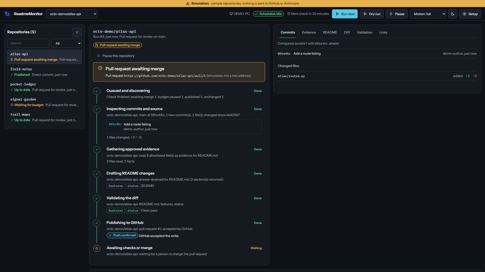

<div align="center">

# ReadmeMonitor

**Keeps your GitHub READMEs accurate: it watches your repositories and drafts evidence-based documentation updates for you to review.**


[Getting started](docs/getting-started.md) · [Operations](docs/operations.md) · [Configuration](docs/configuration.md) · [Troubleshooting](docs/troubleshooting.md) · [Privacy](docs/privacy.md) · [Verification](docs/verification.md)

</div>



*The workbench during a simulated run (`readme-monitor ui --demo`): invented sample repositories; nothing was sent to GitHub or Anthropic. More: [setup screen](docs/screenshots/setup.png), [3840×2160](docs/screenshots/workbench-4k.png), [phone width](docs/screenshots/workbench-mobile.png).*

## Overview

A README goes stale quietly: a command is renamed, a setting is added, a release ships, and the
front page of the project still describes last month. ReadmeMonitor is a small background tool
for Windows that notices those changes and drafts the update for you.

It is for people who keep several GitHub repositories and want their documentation to follow the
code without writing every update by hand. When something that matters to the documentation
changes, it gathers facts from the code (commands, settings, dependencies, releases, test
results), asks Claude (an AI model from Anthropic) to update only the README sections it is
allowed to maintain, checks the answer against those facts, and opens a pull request for you to
review. Text you wrote by hand outside those sections is never touched. Source code is sent to
Claude only for repositories you approve one by one; the rest get the sections that can be built
from GitHub itself (project layout, releases).

You set it up in a page that runs in your browser on your own computer. Nothing is hosted
anywhere, and nothing is spent, published or scheduled until you switch it on.

## What you can do

<!-- readme-monitor:start:features hash=d1998ea0ed31 -->
| When you need to… | ReadmeMonitor… |
| --- | --- |
| Set it up without editing files | Walks you through six steps in a local browser page and writes the settings file for you |
| See what it is doing | Shows every stage of every check (commits examined, evidence read, the proposed README and its diff, the validation result) and the run history and spending |
| Cover every repository you own | Lists all of the account's repositories (every page), follows renames by repository id, and shows each one's status, including the ones it cannot maintain yet and why |
| Keep setup instructions current | Extracts commands, entry points, dependencies and runtime versions from the code and updates the matching sections |
| Avoid paying for nothing | Makes zero Claude requests when the relevant content has not changed, and waits for a burst of commits to settle before one paid update |
| Stay in control of wording | Writes only inside named managed blocks; edits you make inside one are detected and never overwritten |
| Review before anything changes | Proposes one pull request per repository (`review_pr`), or only writes local previews (`preview`) |
| Let routine updates flow | `auto_pr` asks GitHub to auto-merge when the content has no review flags and your branch rules pass; `direct` (opt-in) makes one ordinary commit to the branch |
| Run on your schedule | Manual only, every N minutes, daily or on chosen weekdays, registered with Windows Task Scheduler and read back so you can see what Windows really holds |
| Keep spending predictable | One shared ledger: per-run, daily and monthly limits across all repositories, paced over the month, oldest waiting repository first |
| Keep private code private | Sends source only for repositories you approve one by one, never secret-like files, and redacts secret-looking values first |
| Adopt an existing README | `init --dry-run` shows a reviewable diff that only adds markers and missing sections; discovered repositories get adoption pull requests in small daily batches |
| Try it without risk | A built-in simulation with invented repositories, and dry runs that read GitHub but write nothing and cost nothing |
<!-- readme-monitor:end:features -->

## Current status and limitations

<!-- readme-monitor:start:status hash=8ae145079155 -->
| Area | State |
| --- | --- |
| Version | 0.3.0, pre-release: no release has been published yet |
| Where the worker runs | Windows only (developed and checked on Windows 11). Other systems can run the tests, dry runs and the offline commands |
| Model provider | Anthropic is the only provider |
| Automated tests | 282 tests pass against simulated GitHub, Claude and Task Scheduler (one more is skipped where Windows does not allow symbolic links), including one acceptance test per release criterion; direct publication is also tested against a real local Git repository (not GitHub). The CI workflow runs them on Windows and Linux; see the [verification record](docs/verification.md) for results |
| Setup interface | Served, paired and fetched by automated tests and by a clean-install check; its compiled assets are scanned for secrets, external addresses and inline code. Layout from 375 px wide to an emulated 3840×2160 screen was checked in Chrome; keyboard-only use, touch, screen readers and a physical 4K display are still to be checked by hand |
| Real services | Earlier versions made read-only requests to real GitHub, one real model request and opened one real pull request (never merged). Version 0.3.0 has read a real GitHub repository in dry runs, from the command line and from the interface (no model request, no GitHub write). A live run with the real provider, merge confirmation and direct commits on GitHub are unverified |
| Scheduled task | Every schedule form was registered with the real Windows Task Scheduler and read back, using a harmless test action. A scheduled run of the worker itself has not been verified |
| Licence | Apache License 2.0 |

Limitations:

- Checks run only while you are signed in to Windows and the computer is awake; a check missed
  while it was asleep or off runs once when it is available again.
- Very large repositories (a Git tree GitHub truncates) are reported as errors rather than processed.
- One README template (PopL Repository Standard v1) is available.
- Do not run the same set of repositories from two enabled installations: each has its own
  spending ledger and they would not coordinate.

What was checked, how, and what was not: [docs/verification.md](docs/verification.md).
<!-- readme-monitor:end:status -->

## Getting started

You need Windows 11, PowerShell (already included) and
[Python 3.11 or newer](https://www.python.org/downloads/) (tick "Add python.exe to PATH" when
installing). You do not need to be a programmer.

1. **Get the files.** Download this repository as a ZIP file (**Code → Download ZIP**) and unzip
   it, or clone it with Git: `git clone https://github.com/poplislive/readme-monitor.git`.
   Open PowerShell in that folder.
2. **Install.** This creates a private Python environment, installs the exact library versions,
   creates your settings folder and runs a health check. It stores no credential, enables
   nothing, schedules nothing and spends nothing.

   ```powershell
   .\scripts\install.ps1
   ```

   If Windows says scripts are disabled or not signed, run it once like this instead (no Windows
   setting is changed):

   ```powershell
   powershell -NoProfile -ExecutionPolicy Bypass -File .\scripts\install.ps1
   ```

3. **Start the interface.** Double-click **`ReadmeMonitor.cmd`**, or run `.\scripts\start.ps1`. Your
   browser opens a page that is served from your own computer only. Keep the window open while
   you use it.
4. **Look around first (optional).** `.\scripts\start.ps1 -Demo` starts a simulation with
   invented repositories and a scripted stand-in for GitHub and Claude. Nothing real is contacted
   and the temporary data is deleted when you stop it.

The full walkthrough, including where to get a GitHub token and what each choice means, is in
[Getting started](docs/getting-started.md).

## Using the interface

**Setup** has six steps, and each shows what the program has confirmed:

1. **This computer.** Choose where your data lives and, when you are ready, enable the worker for
   this folder on this computer. Until then it can only read and draft.
2. **GitHub.** Paste a token. It is checked once, then stored in Windows Credential Manager.
3. **Repositories.** Pick which repositories to enroll and which README sections may be written.
   Sending source files to Claude is off unless you turn it on for that repository and confirm.
4. **Model and spending.** Optionally add an Anthropic key and set the three spending limits.
   Without all three, no paid request is ever made.
5. **Publication and schedule.** Choose preview only, a pull request for review (recommended
   first), a pull request that merges itself, or a direct commit; then choose when checks run.
6. **Dry run and start.** See the drafts the program would propose, without any cost or any
   change on GitHub.

The **workbench** then shows a list of repositories, and for the one you select, the stages of its
latest check: inspect, evidence, draft, validate, publish and result, with the commits examined,
the files read, the proposed README, the diff and the validation notes. The schedule bar shows
when the next check runs and whether Windows holds what you configured. **Run now**, **Pause** and
**Cancel** are in the top bar. Closing the page changes nothing; checks keep running.

The same actions are available as commands (`readme-monitor --help` lists them), for example
`doctor`, `status`, `run-once --dry-run`, `pause` and `resume`.

## Configuration

<!-- readme-monitor:start:configuration hash=f342bb0089b6 -->
Settings live in `%USERPROFILE%\ReadmeMonitor\config.toml` (TOML). The setup interface edits this
file for you; you can also edit it by hand. Credentials are never stored there; they are saved in
Windows Credential Manager for the account that runs the monitor.

| Setting | Where | What it controls |
| --- | --- | --- |
| `mode`, `interval_minutes`, `time`, `weekdays`, `timezone` | `[schedule]` | When checks run: manual, every N minutes, daily or on chosen weekdays, at this computer's time or UTC |
| `host_lock` | `[installation]` | Optional: only the computer with this name may enable the worker |
| `poll_interval_minutes` | `[monitor]` | The interval used when there is no `[schedule]` table (default 5) |
| `model`, `effort`, `max_output_tokens` | `[monitor]` | The Claude model (default `claude-sonnet-5-5`) and request size |
| `quiet_minutes`, `min_generation_interval_hours`, `max_postpone_hours` | `[monitor]` | When a paid update may run (defaults 30 minutes, 12 hours, 24 hours) |
| `per_run_usd`, `daily_usd`, `monthly_usd`, `pacing` | `[budget]` | Shared spending limits; all three amounts are required before any paid request, and none is pre-filled |
| `owner`, `publish_mode`, `adoptions_per_day`, `exclude` | `[discovery]` | Every repository an account owns, and how they are handled |
| `export_restricted` | `[policy]` | Repositories whose content is never sent to Claude |
| `name`, `branch`, `readme_paths` | `[[repo]]` | Which repository, branch and README files are maintained |
| `source_include`, `source_exclude` | `[[repo]]` | Which files may be read (and, with `api_export = "allowlist"`, sent to Claude) |
| `managed_sections`, `disabled_sections` | `[[repo]]` | Which standard sections the monitor writes |
| `publish_mode` | `[[repo]]` | `preview`, `review_pr`, `auto_pr` or `direct` |

The full reference is in [docs/configuration.md](docs/configuration.md).
<!-- readme-monitor:end:configuration -->

## Architecture

<!-- readme-monitor:start:architecture hash=0ec2e70566d7 -->
ReadmeMonitor is a short-lived Python worker started by Windows Task Scheduler, plus a small local
web server (`readme-monitor ui`) that shows and controls it. Live work (spending, publishing,
scheduling) is allowed only for a runtime folder that you enabled on this computer. Each check
takes a lock, looks at your repositories through the GitHub API, and exits.

1. **Discover.** Every few hours it lists every repository the account owns and records renames,
   transfers, archives and lost access by repository id. A failed listing changes nothing.
2. **Detect.** Conditional requests for the branch head and releases cost nothing when nothing changed.
   Changes are measured by file content, so many commits, squash or rebase merges and downtime all
   lead to a single proposal. Up to 10 repositories per run, least recently checked first.
3. **Gather evidence.** Code extracts commands, settings, dependencies, documentation paths,
   releases and check results for the exact revision.
4. **Generate.** Only for approved repositories whose relevant inputs changed, after a quiet period,
   and if the shared budget allows: Claude receives the bounded, redacted evidence and returns JSON
   with section text and evidence references.
5. **Validate.** Code rejects unrequested sections, invented evidence, markers, headings and active
   HTML, and flags unsupported commands, settings, links and claims for review.
6. **Publish.** One monitor-owned branch and pull request per repository, after checking that the
   branch has not moved and nobody else has written to the bot branch; or, for repositories that
   opted in, one ordinary commit to the branch.

State, usage accounting, activity events and proposals are kept in SQLite. Details:
[docs/architecture.md](docs/architecture.md); the interface contract: [docs/api.md](docs/api.md).
<!-- readme-monitor:end:architecture -->

## Project structure

<!-- readme-monitor:start:project-structure hash=5d7c7cbe0345 -->
Top-level layout of the default branch:

```text
.github/
docs/
readme_monitor/
scripts/
tests/
ui/
CHANGELOG.md
CONTRIBUTING.md
LICENSE
NOTICE
pyproject.toml
README.md
ReadmeMonitor.cmd
readmemonitor.py
requirements-dev.txt
requirements.txt
SECURITY.md
THIRD_PARTY_NOTICES.md
```
<!-- readme-monitor:end:project-structure -->

## Development and testing

<!-- readme-monitor:start:development hash=f0fabf91c8f0 -->
```powershell
.\scripts\install.ps1 -Dev
.\.venv\Scripts\python.exe -m pytest -q
```

The tests run against simulated GitHub repositories, a scripted Claude client and a stand-in for
Task Scheduler, so they need no credentials and never spend money. Besides the single-repository
behavior (no-ops, section-scoped updates, update loops, budgets, human edits, stale branches,
invalid output, publication), they cover account discovery, activation and migration, schedules,
the local interface server and one acceptance test per release criterion, including a direct
publication test against a real local Git repository. The compiled interface is committed in
`readme_monitor/web/`; to change it, work in `ui/` (`npm ci`, `npm run build`). CI runs the
Windows installer plus tests, a clean-install check, the portable tests on Linux, and the
interface build. See [CONTRIBUTING.md](CONTRIBUTING.md).
<!-- readme-monitor:end:development -->

## Where your data lives

- **Runtime folder** (default `%USERPROFILE%\ReadmeMonitor`): `config.toml` (settings), `state.db`
  (history and the spending ledger), `activation.json`, `logs\`, `backups\`, `previews\`. Back up
  with `readme-monitor backup-db`.
- **Credentials**: Windows Credential Manager, for the Windows account that runs the checks. Never
  in files.
- **Program files**: the repository folder and its `.venv`.
- Nothing is sent anywhere except to GitHub, and (only for repositories you approve) to Anthropic.
  Exactly what is sent is listed in [Privacy and data flow](docs/privacy.md).

To move to another computer see [Moving an installation](docs/moving-an-installation.md); to
remove everything see `.\scripts\uninstall.ps1` in the [Operations guide](docs/operations.md).

## Troubleshooting

| Symptom | Where to look |
| --- | --- |
| The installer or launcher will not run, or Python is not found | [Troubleshooting: installing and starting](docs/troubleshooting.md#installing-and-starting) |
| The page says to open ReadmeMonitor from its launcher | Start it again with `ReadmeMonitor.cmd`; see the same page |
| "Not enabled", or a copied folder will not run | [Troubleshooting: enabling and the computer](docs/troubleshooting.md#enabling-and-the-computer) |
| Nothing runs while I am signed out or asleep | [Troubleshooting: schedule](docs/troubleshooting.md#schedule-and-background-running) |
| A repository shows `budget_paused`, `conflict`, `publish_blocked` or `permission_missing` | [Troubleshooting: a repository's state](docs/troubleshooting.md#a-repositorys-state) |

First aid for anything: `.\.venv\Scripts\readme-monitor.exe doctor` prints one `PASS`, `WARN` or
`FAIL` line per check with the reason.

## More information

[Getting started](docs/getting-started.md) · [Operations guide](docs/operations.md) ·
[Configuration reference](docs/configuration.md) · [Architecture](docs/architecture.md) ·
[Local API contract](docs/api.md) · [Interface design](docs/design.md) ·
[Privacy and data flow](docs/privacy.md) · [Security policy](SECURITY.md) ·
[Moving an installation](docs/moving-an-installation.md) · [Troubleshooting](docs/troubleshooting.md) ·
[Verification record](docs/verification.md) · [README design](docs/readme-design.md) ·
[Changelog](CHANGELOG.md) · [Contributing](CONTRIBUTING.md)

## Recent changes

<!-- readme-monitor:start:recent-changes hash=d016c55cc65f -->
No releases have been published yet. See the [commit history](https://github.com/poplislive/readme-monitor/commits/main) for changes.
<!-- readme-monitor:end:recent-changes -->

## Roadmap

- Verify a full check against real GitHub and the real provider, and a real scheduled run, and record the result.
- Roll out README adoption across an account in small daily batches.
- Optional GitHub App credential instead of a personal access token.

## Contributing and support

Report problems as GitHub issues and include the output of `readme-monitor status` (it contains
no secrets). Security problems go through [SECURITY.md](SECURITY.md), not an issue. Contributions are
welcome under the project's licence; see [CONTRIBUTING.md](CONTRIBUTING.md).

## License

Licensed under the [Apache License, Version 2.0](LICENSE). See [NOTICE](NOTICE). The compiled
interface bundles third-party packages and fonts under their own licences, listed in
[THIRD_PARTY_NOTICES.md](THIRD_PARTY_NOTICES.md).
